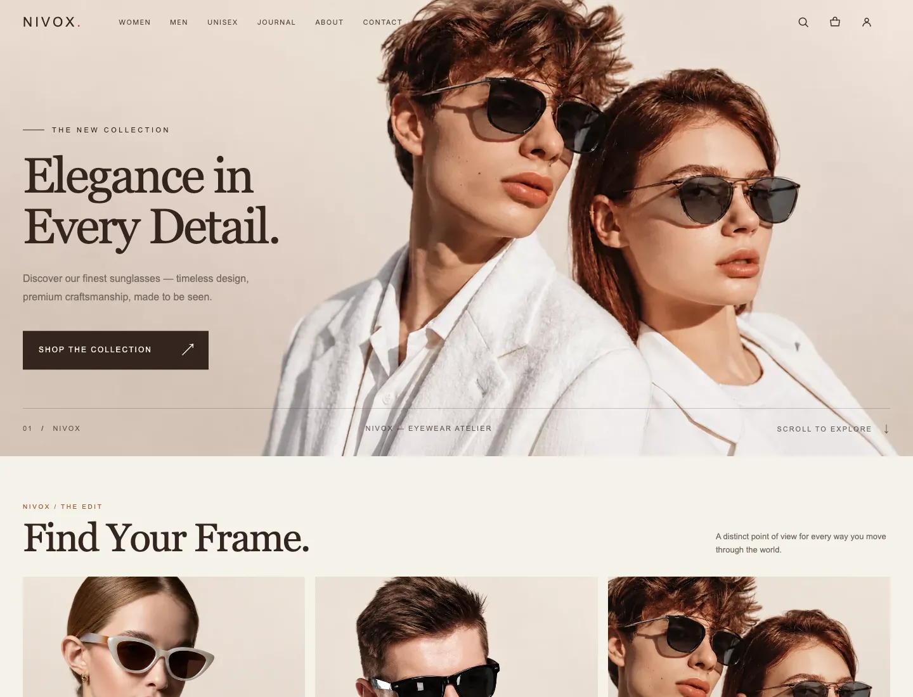
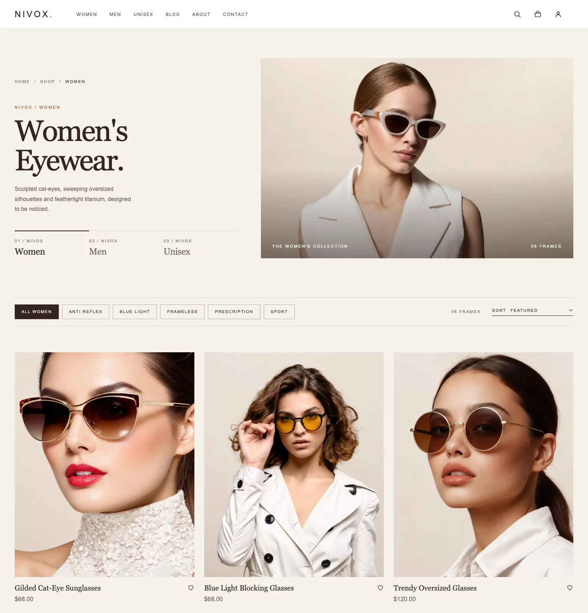
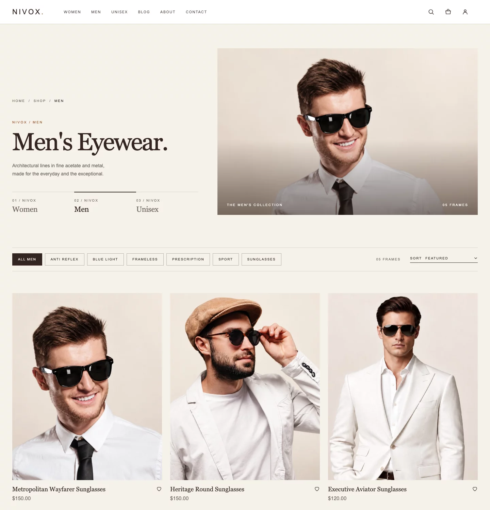
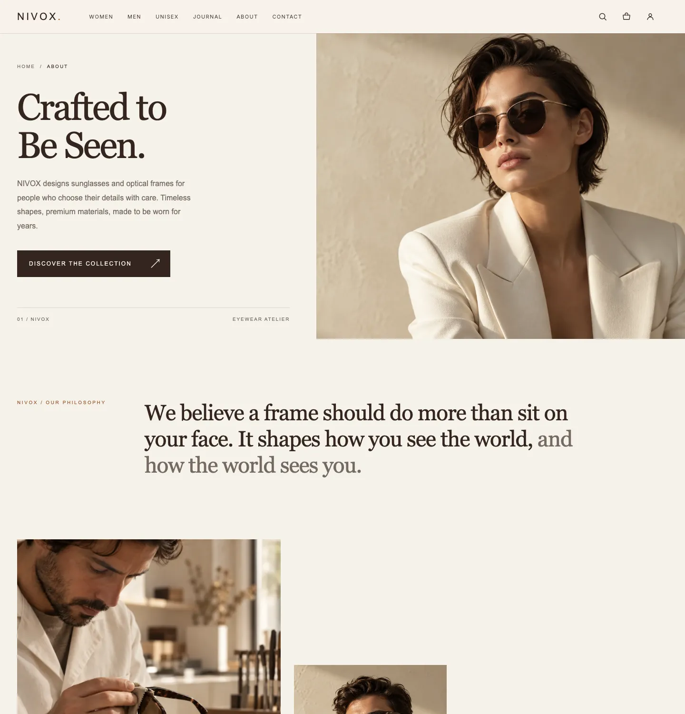
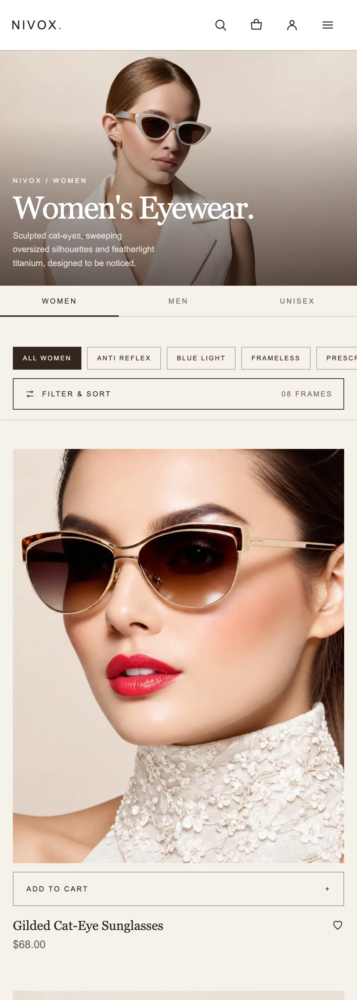
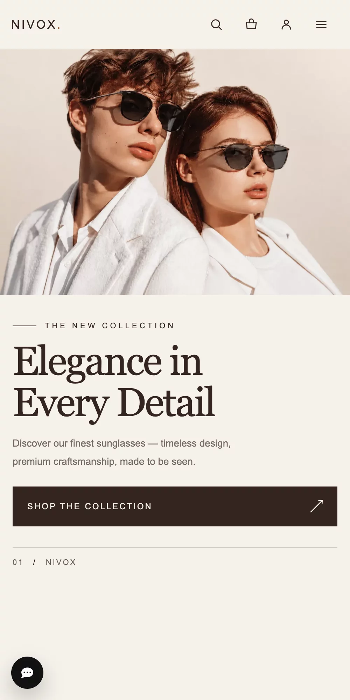

# NIVOX

**A custom e-commerce storefront for a premium eyewear brand.**

NIVOX is a complete, working online store, designed and built from scratch: a quiet, editorial storefront for women's, men's and unisex eyewear. The brand is fictional; the store is real. This page introduces the project. The source code is kept in a private repository.

**[Open the live store →](https://venzoh.com/nivox/)** · **[Read the case study](https://venzoh.com/work/nivox)**

## Try it

Everything on the live store works: browse the collections, add frames to the bag and check out.

- Open the account icon and choose **Continue as Demo** to shop as a signed-in customer.
- Payments run in Stripe's test mode, so nothing real is charged. Each visitor works in a private copy of the store's data.

## Design

The design treats eyewear the way a fashion house would: generous space, large photography, and very little decoration.

- **Palette:** warm cream and sand grounds, a deep espresso ink for text, and a single rust accent.
- **Type:** Georgia headlines with tight tracking, paired with small, widely spaced capitals for labels and buttons.
- **Shape:** square corners throughout, hairline rules, and photography that does the talking.

Every page follows the visual language set by the homepage, so the store reads as one brand from the first screen to checkout.

### On mobile

  
  &nbsp;&nbsp;
  

## Highlights

**Storefront**
- Campaign homepage with a hero that adapts its layout to desktop, tablet and mobile
- Women, Men and Unisex collections with style filters, sorting and a price range; switching between them happens in place, with its own URL and Back/Forward support
- A frosted-glass Add to Cart that slides in on hover, and a mobile Filter & Sort sheet
- Product pages with gallery and reviews, cart, checkout and order history, favorites
- A journal with categories and search on clean addresses, a category bar that stays in reach while reading, and comments
- Live support chat

**Under the hood**
- PHP 8.2 and MySQL / MariaDB, with no framework
- Stripe Checkout with signed webhooks, and installment plans
- Phone OTP and Google sign-in
- A seed that rebuilds the whole showcase store, photos included, with one command
- Continuous integration on every change: syntax checks, a repository safety check, the seed run twice on a fresh database, integration tests, and a smoke test of the storefront pages

## Rights

© 2026 Zohre Tabatabaei. All rights reserved.

The NIVOX design and code are not open source and are not available for reuse (see [LICENSE](LICENSE)). If the design is licensed, it belongs exclusively to that licensee. For inquiries, contact the author through GitHub.
